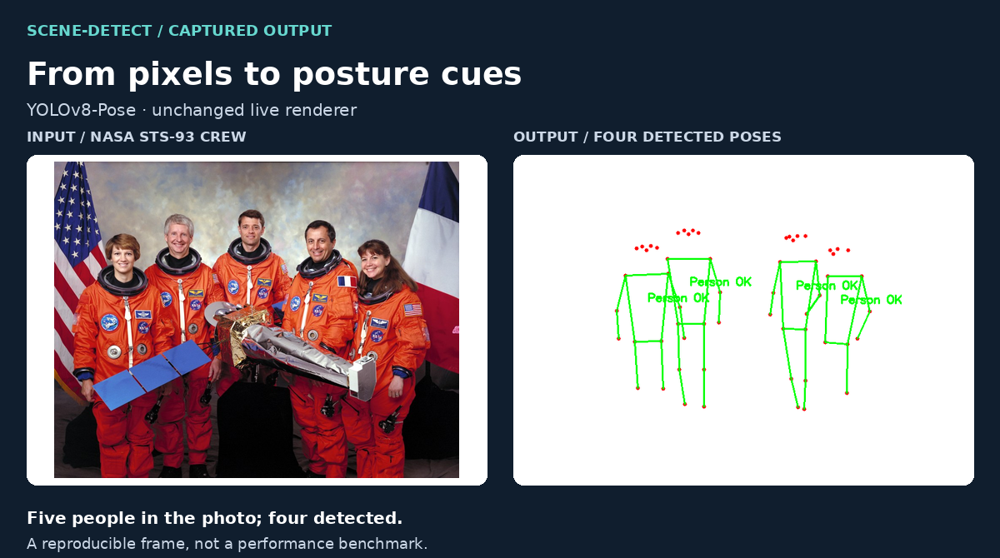
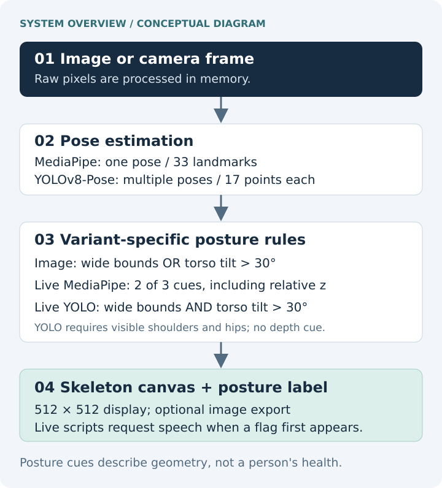
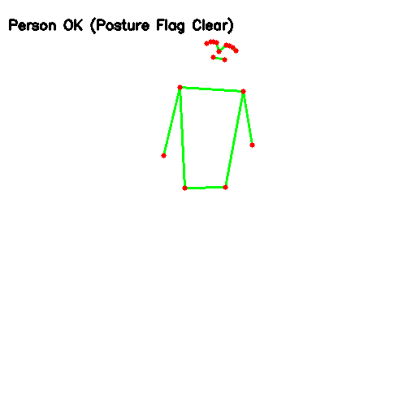
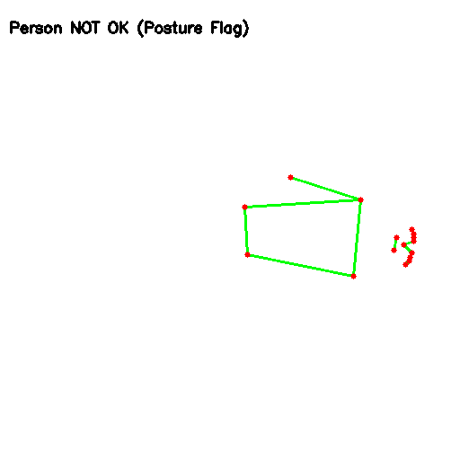
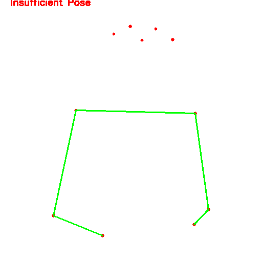

# scene-detect

**Pose estimation, skeleton visualization, and interpretable posture rules.**

An experimental team project from OTH Amberg-Weiden. Three Python demos turn an image or camera stream into a skeleton view using MediaPipe or YOLOv8-Pose, then assign a heuristic posture label.

<picture>
  <source media="(max-width: 640px)" srcset="docs/assets/scene-detect-demo-mobile.png">
  
</picture>

*Actual inference on a local still image replayed through the live YOLO script; GUI and speech were intercepted for capture. Four poses were detected among five people. Photo: NASA; informational demonstration, no endorsement. [Commands, original canvases, and provenance](docs/DEMONSTRATIONS.md).*

[Quick start](#quick-start) · [Variants](#choose-a-variant) · [Example outputs](#example-outputs) · [Technical overview](docs/TECHNICAL_OVERVIEW.md) · [Evaluation protocol](EXPERIMENTS.md)

## What it does

The project explores how a scene can be summarized through body keypoints instead of a full-color display. It includes:

- A headless image CLI that prints a label and optionally saves a 512 × 512 skeleton canvas.
- A single-person MediaPipe camera viewer with 33 estimated landmarks.
- A multi-person YOLO camera viewer with 17 keypoints per detected person and labels near each torso.
- Spoken notifications in the live scripts when the posture flag first appears.

**The labels describe posture rules, not well-being.** `Person OK` means the rule did not trigger; it does not establish safety. `Person NOT OK` is a posture flag, not evidence of distress. `No Person Detected` does not establish an empty room. YOLO can also report `Insufficient Pose`.

## Choose a variant

| | Image / MediaPipe | Live / MediaPipe | Live / YOLOv8-Pose |
| --- | --- | --- | --- |
| Entry point | [Image CLI](detection_with_images.py) | [MediaPipe viewer](detection_with_live_mediapipe.py) | [YOLO viewer](detection_with_live_yolo.py) |
| Input | One explicitly selected image | Camera index `0` | Camera `0`; configurable source |
| Pose capacity | One | One | Multiple |
| Flag rule | Wide bounds **OR** tilted torso | **2 of 3** cues | Wide bounds **AND** tilted torso |
| Third cue | None | Relative-z spread `< 0.1` | None; 2D only |
| View | One centered skeleton | One centered skeleton | Shared scale across detected poses |
| Output | Printed label; optional file/window | Window + speech on flag entry | Window + speech when any flag first appears |

All torso-angle thresholds are **greater than 30°** from vertical. These variants do not produce interchangeable classifications. [Exact rules and visibility handling](docs/TECHNICAL_OVERVIEW.md#posture-rules).

## System overview



Skeleton-only rendering reduces what the viewer displays. Raw RGB frames still enter the estimators in memory. Dropping Python references is not verified erasure of library buffers or a privacy-compliance guarantee.

## Quick start

Run commands from the repository root. The recorded inference runs used **Linux and Python 3.10.12** with an existing environment; a clean install and Windows execution have **not** been verified.

```bash
git clone https://github.com/dvkkishore/scene-detect.git
cd scene-detect
python3.10 -m venv .venv
source .venv/bin/activate
python -m pip install -r requirements_demo.txt
```

On Windows, create the environment with `py -3.10 -m venv .venv` and activate it with `.venv\Scripts\Activate.ps1` in PowerShell.

[requirements_demo.txt](requirements_demo.txt) lists the direct demo dependencies at the versions used for the recorded runs. Ultralytics also installs PyTorch; the recorded environment had PyTorch **2.7.0+cu126** and inference ran on CPU. The original Linux/Windows requirement files remain as historical exports: the Linux file includes ROS packages, and the Windows file omits MediaPipe and Ultralytics. They are not portable setup recipes.

### Process an image

A small, credited NASA example is included so the first run does not depend on the older photos with unresolved provenance:

```bash
python detection_with_images.py \
  --image docs/assets/inputs/nasa-astronaut.jpg \
  --output demo_frames/skeleton.png
```

Expected label in the recorded environment: `Person OK (Posture Flag Clear)`. Add `--show` for an OpenCV window. Without `--output`, the CLI prints the label without saving a file; it does not scan the sample folders.

The image path uses MediaPipe's legacy `mp.solutions.pose` API and the heavy pose model. The pinned version provides that API; MediaPipe may need to download model data on first use. The recorded environment already contained the model files.

### Run a camera viewer

```bash
python detection_with_live_mediapipe.py
# Or, for multiple people:
python detection_with_live_yolo.py
```

Both require a working camera, desktop OpenCV display, and an OS speech backend for `pyttsx3` (such as eSpeak on Linux). Speech initializes at startup; these scripts have no mute flag. Press **q** in the preview window to exit.

YOLO loads the included `yolov8n-pose.pt` from the working directory. To use another camera or a local video in a POSIX shell:

```bash
SCENE_DETECT_CAMERA=1 python detection_with_live_yolo.py
SCENE_DETECT_CAMERA=/path/to/clip.mp4 python detection_with_live_yolo.py
```

In PowerShell, set `$env:SCENE_DETECT_CAMERA = '1'` before running the script. MediaPipe's viewer uses camera `0` directly in its source. For a headless replay of either live variant, use the [capture commands](docs/DEMONSTRATIONS.md#reproduce-the-live-script-captures).

## Example outputs

These are saved canvases from actual model inference, with no redrawn keypoints or substituted labels. The rotation is an **image-orientation stress check**, not footage of a lying person or a fall.

| Image CLI: portrait | Image CLI: rotated 90° | YOLO: partial-body portrait |
| --- | --- | --- |
|  |  |  |
| Flag clear | Flag triggered by orientation | Shoulders/hips lack sufficient confidence |

The image CLI also returned `No Person Detected` on a generated white image. The live MediaPipe script returned `Person OK` on the portrait and `Person NOT OK` on its rotation, requesting “Person not okay!” in the latter run; speech was muted by the capture tool. [All seven execution records and full-size outputs](docs/DEMONSTRATIONS.md#recorded-results).

## Evaluation and limitations

The [existing regression tests](tests/) check classifier logic and CLI behavior; additional capture tests check replay and export I/O. Run them with:

```bash
python -m unittest discover -s tests -v
```

The documentation captures establish that the recorded inputs passed through the estimators, rules, and renderers. They do not measure accuracy, speed, or emergency-detection performance. No camera device was available for this verification; live camera behavior, sustained tracking, and audible notifications remain unverified.

Viewpoint, occlusion, incomplete bodies, and harmless reclining can change the output. MediaPipe's relative z is uncalibrated, and its normalized-coordinate geometry differs from YOLO's pixel geometry. Neither variant identifies a fall over time or assesses a person's health. The crew example also shows a missed person. See the [proposed evaluation protocol](EXPERIMENTS.md) before reporting performance.

## Repository guide

| Path | Contents |
| --- | --- |
| `detection_with_*.py` | Three demonstration entry points |
| [pose_classifier.py](pose_classifier.py) | Pure 2D posture rule used by YOLO |
| [docs/TECHNICAL_OVERVIEW.md](docs/TECHNICAL_OVERVIEW.md) | Geometry, input/output behavior, and implementation trade-offs |
| [docs/DEMONSTRATIONS.md](docs/DEMONSTRATIONS.md) | Reproduction commands, verification evidence, and asset provenance |
| [EXPERIMENTS.md](EXPERIMENTS.md) | Proposed evaluation protocol; no empirical scores |
| `docs/assets/` | Small documented inputs, captured canvases, diagrams, and run records |
| `tools/` | Documentation capture and layout generation; no detector changes |
| `tests/` | Classifier, CLI, and capture I/O checks |
| `Person OK/`, `Person not OK/`, `Nobody/` | Original sample photographs; redistribution provenance unresolved |

Original photographs and model weights are preserved. The repository has no top-level license file; this documentation change does not grant a new license for the existing code, weights, or samples. Added image sources and usage terms are recorded in the [provenance notes](docs/DEMONSTRATIONS.md#asset-provenance).

## Contributors and attribution

**Farrukh Rasool, Ammad Majid, Sai Pavan Bolagani, Syed Annas Jawed, Soham Shripad Kharadkar, and Venkata Kishore Dannana.**

Smart Scene Detect Project, **OTH Amberg-Weiden**. Course: **Industry 4.0 Project / Artificial Intelligence for Industrial Applications**.

This is a collaborative project. Individual subsystem responsibilities are not assigned here; the original author list and contributor history are preserved.
