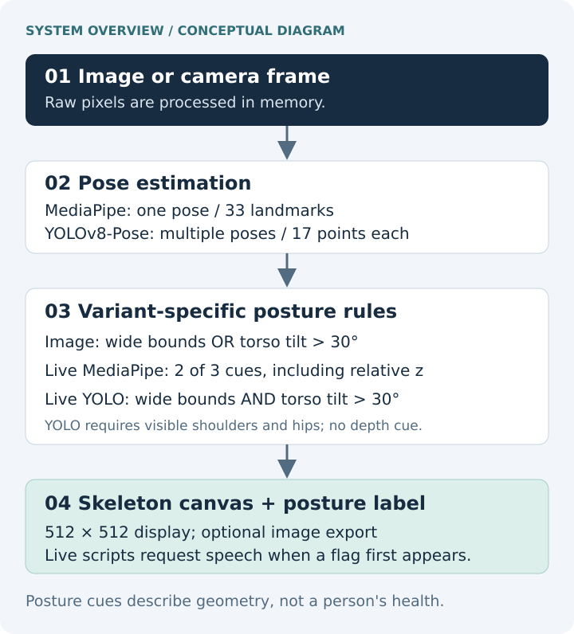

# Technical overview

Scene-detect separates pose estimation from posture classification: a pretrained estimator supplies body keypoints, a small geometric rule supplies a label, and OpenCV renders a skeleton canvas. The rules are interpretable, but their outputs do not establish health or safety.

## Data flow



The three entry points share this pattern, but do not share one classifier. Only the YOLO viewer imports [pose_classifier.py](../pose_classifier.py). MediaPipe's image and camera scripts contain their own rules.

| Stage | Image / MediaPipe | Live / MediaPipe | Live / YOLO |
| --- | --- | --- | --- |
| Read | `cv2.imread(--image)` | `VideoCapture(0)` | `VideoCapture(SCENE_DETECT_CAMERA)`; defaults to `0` |
| Estimate | Static mode, complexity `2` | Video mode, complexity `1`, detection confidence `0.5` | Included `yolov8n-pose.pt`, prediction confidence `0.5` |
| Coordinates | 33 normalized landmarks | 33 normalized landmarks, relative z | 17 points per person: pixel x, pixel y, confidence |
| Classify | Inline OR rule | Inline voting rule | Pure AND rule in `pose_classifier.py` |
| Render | One centered skeleton | One centered skeleton | All visible poses share a scale and offset |
| Export | Optional `--output`; optional `--show` | Window only | Window only |

The offline CLI prints its label even without an output file. It reads one file, not a folder of examples. Its optional file output is a skeleton visualization, not a copy of the input photograph.

## Posture rules

### Shared geometry

The torso vector points from the midpoint of the shoulders to the midpoint of the hips. Each rule computes `abs(degrees(atan2(torso_x, torso_y)))`, then folds angles greater than 90° with `180 - angle`. The resulting angle is in [0°, 90°], measured from the image's vertical axis. A torso angle **greater than 30°** supplies a tilted-torso cue; exactly 30° does not.

Bounds come from landmark extrema, not a person detector's bounding box. A **width greater than height** supplies the wide-bounds cue. In the MediaPipe scripts, x and y are normalized separately by image width and height. Their ratios and angles can therefore depend on input aspect ratio. YOLO's helper operates on pixel coordinates and is a different geometry.

### Image / MediaPipe

[detection_with_images.py](../detection_with_images.py) returns:

```text
No pose landmarks                   → No Person Detected
Wide bounds OR torso angle > 30°     → Person NOT OK (Posture Flag)
Otherwise                           → Person OK (Posture Flag Clear)
```

The bounds and torso calculation use landmarks without filtering for visibility. Only drawing is filtered: a joint must have visibility `> 0.5`, and a connection requires both ends above that threshold. A faint or hidden estimated landmark can influence the rule without appearing on the canvas.

### Live / MediaPipe

[detection_with_live_mediapipe.py](../detection_with_live_mediapipe.py) uses three votes:

1. Bounds wider than tall.
2. Torso angle greater than 30°.
3. Standard deviation of all landmark relative-z values less than `0.1`.

At least **two votes** produce `Person NOT OK`; otherwise the label is `Person OK`. Missing pose landmarks produce `No Person Detected`. Like the image script, classification uses all landmarks while drawing filters visibility.

Relative z is a model estimate, not a calibrated distance sensor. The z-spread threshold is an experimental cue, not a validated sign of lying down. MediaPipe's video mode can use earlier frames; the documented one-frame replays do not test sustained tracking.

### Live / YOLO

[pose_classifier.py](../pose_classifier.py) treats a point as usable when its confidence is `> 0.5` and all three values are finite. It checks:

```text
Malformed array (not N × 3)                  → ValueError
No usable points                            → No Person
Fewer than 13 rows or 4 usable points        → Insufficient Pose
Any shoulder/hip unusable (5, 6, 11, 12)      → Insufficient Pose
Zero width AND zero height                  → Insufficient Pose
Wide bounds AND torso angle > 30°            → Person NOT OK
Otherwise                                   → Person OK
```

The helper can return `No Person`; the viewer skips poses with no keypoint confidence above `0.5` and shows the frame-level `No Person Detected` when no such keypoints exist. These are different output strings at different layers.

YOLO keypoints contain **no depth coordinate**. The current helper uses no z proxy. It is invariant to a common positive scale of x and y, but is sensitive to camera orientation and incomplete or misplaced keypoints. It does not track a person's identity or detect a fall as a temporal event.

## Rendering and notifications

All canvases are 512 × 512 with white backgrounds, green connections, and red joints. MediaPipe centers one pose and fits its normalized bounds into roughly 80% of the canvas. YOLO fits all confidence-filtered poses into one shared set of bounds, preserving their relative arrangement under that transform; this is not a calibrated room map.

YOLO draws torso labels in green for `Person OK` and red for other returned labels, including `Insufficient Pose`. The red color is a rendering choice, not a health assessment. Labels can overlap or extend beyond the canvas. The capture tool retains those artifacts.

The live scripts initialize `pyttsx3` on startup and block on `runAndWait()` when requesting speech:

| Script | Trigger | Exact speech request |
| --- | --- | --- |
| MediaPipe | Current label is `Person NOT OK` and differs from previous frame's label | `Person not okay!` |
| YOLO | At least one `Person NOT OK`, with no active remembered flag | `Alert. Person not okay.` |

YOLO's no-visible-keypoints branch continues before updating its alert state. Consequently, a gap with no visible keypoints does not necessarily reset the remembered flag. Neither script implements a timed cooldown, external notification service, or emergency-response integration.

## Frame handling and privacy

The scripts process raw images before drawing skeletons. They delete local frame references after inference; YOLO additionally clears `results[0].orig_img`. This is not an audit of internal estimator/camera buffers or guaranteed erasure. Existing source photographs remain on disk, and the original sample folders are tracked. A skeleton display alone does not establish anonymization or compliance.

The documentation capture tool redirects local file input and intercepts display, key polling, and speech. It runs the existing estimator, classification, and drawing code. It neither supplies synthetic keypoints nor changes the labels. See [DEMONSTRATIONS.md](DEMONSTRATIONS.md) for execution records and the exact verification boundary.

## Evaluation and maintenance

The unit tests establish selected classifier cases and CLI argument behavior. Capture I/O tests check the helper's replay/export boundary. None measures real-world precision, recall, false alerts, or speed. The [proposed evaluation protocol](../EXPERIMENTS.md) describes what is still needed before making performance claims.

The [README](../README.md#repository-guide) maps the repository and preserves the full team attribution. No individual subsystem authorship is inferred from these technical descriptions.
